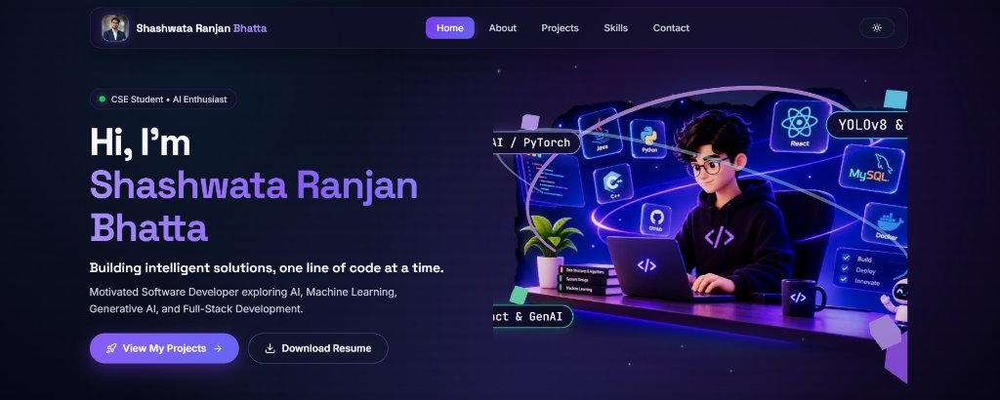

# Interactive 3D Developer Portfolio — Shashwata Ranjan Bhatta

A modern, interactive 3D portfolio website built with **React.js**, **Vite**, **Three.js**, **React Three Fiber**, and **Drei**, showcasing AI/ML, Generative AI, Computer Vision, and Full-Stack MERN engineering projects.



---

## ✨ Features

- **Interactive 3D Hero Stage (`HeroWorkspace3D`)**: Mouse-reactive 3D depth parallax, drag-to-orbit camera controls, volumetric aura glow, orbital neon rings, foreground 3D cube cluster, and clickable 3D crystal badges (`AI / PyTorch`, `YOLOv8 & U-Net`, `React & GenAI`).
- **Profile Lightbox Modal**: Click the navbar avatar to view the full portrait in a glassmorphic modal (`Escape` or click-outside to close).
- **Direct Resume Download**: One-click download of `Shashwata_Ranjan_Bhatta_Resume.pdf` directly from the hero section.
- **Interactive 3D Project Dioramas & Simulators**:
  - Each project renders an auto-rotating 3D sculpture (`ProjectCard3D`) alongside an interactive live widget (`YoloThresholdSimulator`, `UNetMaskSimulator`, `ExpiryStageSimulator`, `TalentScoreSimulator`, `RagPipelineSimulator`).
  - Filter projects by category (`All Projects (5)`, `Computer Vision`, `GenAI & RAG`, `Full-Stack MERN`).
- **Filterable Skills Matrix**: Organized across Programming Languages, AI / Machine Learning, Generative AI, Web Development, Databases, and Tools & Analytics.
- **Dark / Light Theme Toggle**: Smooth theme switching between midnight cosmic indigo and light mode.

---

## 🛠️ Tech Stack

- **Frontend**: React 18, Vite 6, CSS3 Glassmorphism
- **3D Graphics**: Three.js, `@react-three/fiber`, `@react-three/drei`
- **Icons**: `lucide-react`

---

## 📁 Project Structure

```text
├── public/
│   ├── hero-dev.webp                        # 3D hero stage developer artwork
│   ├── profile.jpg                          # Navbar & lightbox portrait
│   └── Shashwata_Ranjan_Bhatta_Resume.pdf   # Direct downloadable resume PDF
├── docs/
│   └── preview.jpg                          # Portfolio preview screenshot
├── src/
│   ├── components/
│   │   ├── CanvasErrorBoundary.jsx          # WebGL fallback boundary
│   │   ├── HeroWorkspace3D.jsx              # Interactive 3D hero workspace
│   │   ├── ProjectCard3D.jsx                # 3D wrapper for project cards
│   │   ├── ProjectDioramas3D.jsx            # 5 bespoke 3D project sculptures
│   │   └── ProjectSimulator.jsx             # Interactive project simulators
│   ├── data/
│   │   └── cvData.js                        # Profile, projects, skills, certs data
│   ├── App.jsx                              # Main layout & sections
│   ├── index.css                            # Theme variables & glassmorphic UI
│   └── main.jsx                             # React entry point
├── .gitignore
├── index.html
├── package.json
└── vite.config.js
```

---

## 💻 Local Development

```bash
# 1. Clone the repository
git clone https://github.com/shashwata777/my-portfolio-.git
cd my-portfolio-

# 2. Install dependencies
npm install

# 3. Start development server
npm run dev

# 4. Build for production
npm run build
```

---

## 🔒 Security

- Verified `0` vulnerabilities via `npm audit`.
- No API keys, tokens, or `.env` files are stored or committed (`.gitignore` excludes `.env*`).
- External links open safely with `rel="noopener noreferrer"`.
